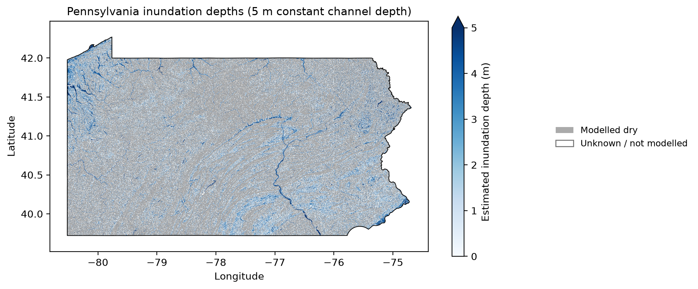

# Pennsylvania Flood Mapping with HAND

For this assignment, I used USGS elevation data to estimate inundation depths across Pennsylvania. I used the Census 2024 state boundary to identify the 25 DEM tiles needed to cover the state.

## What I did
I followed the Pennsylvania example in the course notebook. I filled pits and depressions in the elevation data and resolved flat areas before calculating flow direction and accumulation. I then calculated HAND, or height above nearest drainage, using the original DEM. I used an accumulation threshold of 200 cells to identify drainage cells and assumed a 5 m channel stage.

Where HAND was below 5 m, I calculated inundation depth by subtracting HAND from 5. I used a loop to process all the tiles and saved the HAND and inundation results as GeoTIFFs. I then combined the inundation tiles into one statewide GeoTIFF and clipped it to Pennsylvania. I kept the original 1-arc-second grid and coordinate system (EPSG:4269).

## Results
- Tiles processed: **25 out of 25**.
- Cells with a positive inundation depth: **33,825,413**.
- Maximum calculated depth: **122.53 m**.
- Cells with depths above the assumed 5 m stage: **494,219**.

The blue areas show estimated inundation depths and follow a branching drainage pattern across the state. Gray shows areas classified as dry. White areas within Pennsylvania have no depth or dry classification.

## Limits of the results
The example saves both dry and unknown cells as missing values (NaN) in the depth GeoTIFF. I used the separate HAND files to tell them apart on the map. Each tile was processed separately, so flow paths stop at tile boundaries. Combining the tiles into one image does not fix this and can leave visible seams.

Some calculated depths exceed the 5 m stage because the original ground elevation is below the drainage reference assigned by the model. The maximum of 122.53 m is a model result, not a measured flood depth. This map shows what the example produces under an assumed water level; it does not predict a specific flood event.

## Files and sources
- Statewide GeoTIFF: `PA_inundation_depth.tif`.
- Tile results: `*_hand.tif` and `*_inundation.tif`.
- [USGS 3DEP](https://apps.nationalmap.gov/downloader/).
- [Census 2024 state boundary](https://www2.census.gov/geo/tiger/GENZ2024/shp/cb_2024_us_state_500k.zip).
- Course notebooks: `download-dem.ipynb` and `urban-flood-vulnerability.ipynb`.
