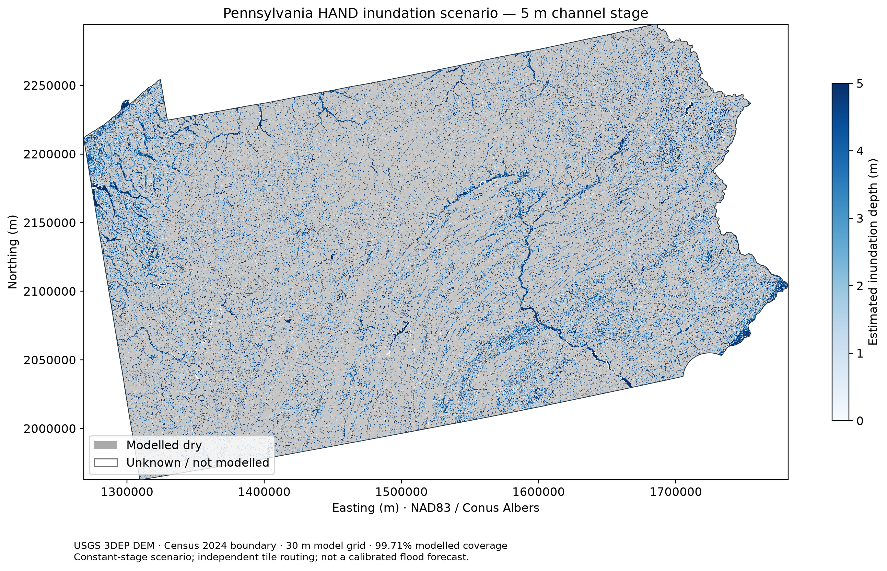

# Pennsylvania inundation mapping with HAND

## Purpose and data
Estimate potential inundation under an assumed **5 m channel stage**
using USGS 3DEP 1-arc-second DEMs and the Census 2024 1:500,000 Pennsylvania boundary.
This run processed **25 of 25 required tiles**.
Run scope: **all required tiles**.

## Method
DEMs were reprojected with bilinear interpolation to an aligned 30 m EPSG:5070 grid.
Pits and depressions were filled, flats resolved, and D8 flow direction and accumulation calculated.
Drainage cells have accumulation greater than 200 cells.
HAND was calculated from the depression-filled DEM along downstream flow paths.
Depth = max(5 − HAND, 0). Tile results were masked to Pennsylvania
and mosaiced using the first valid pixel in overlaps. Depths and HAND are exported separately.

## Results
- Modelled PA grid area: **116,995.21 km²**.
- Modelled coverage of the PA grid footprint: **99.71%**.
- Scenario inundated area: **23,647.04 km²**,
  or **20.21% of modelled area**.
- Modelled dry area: **93,348.17 km²**.
- Unknown / unmodelled PA area: **345.03 km²**.
- Maximum modelled depth: **5.00 m**.

## Interpretation and limitations
Positive depths identify locations below the assumed channel stage relative to their
modelled downstream drainage reference. The scenario does not simulate rainfall, discharge,
flood probability, levees, culverts, or hydraulic backwater. Permanent water is not removed.
Unknown areas are not dry. Independent tile routing truncates contributing areas and
downstream paths; mosaicing does not repair these seams. Depression filling and the
uncalibrated stream threshold also affect results. The generalized boundary and overview
map are unsuitable for parcel-level interpretation. Narrow channels may not appear in
the downsampled figure. Inspect the GeoTIFF for local detail.

## Files and reproducibility
- State/partial mosaic: `PA_inundation_depth_m.tif` (metres; NoData = -9999; dry = 0).
- Tile HAND and depth files: `tiles/`.
- Source inventory: `download_manifest.csv`; expected tiles: `required_tiles.csv`.
- Parameters and package versions: `parameters.json`; areas: `area_summary.csv`.
- Run ID: `d3ae8127e34c`; report generated: 2026-09-29T22:46:48.985043+00:00.

## Sources
- [USGS National Map](https://apps.nationalmap.gov/downloader/)
- [Census boundary download](https://www2.census.gov/geo/tiger/GENZ2024/shp/cb_2024_us_state_500k.zip)
- [PySheds](https://github.com/mdbartos/pysheds)
- [Rasterio merge](https://rasterio.readthedocs.io/en/stable/api/rasterio.merge.html)
- Course notebooks: download-dem.ipynb and urban-flood-vulnerability.ipynb.
